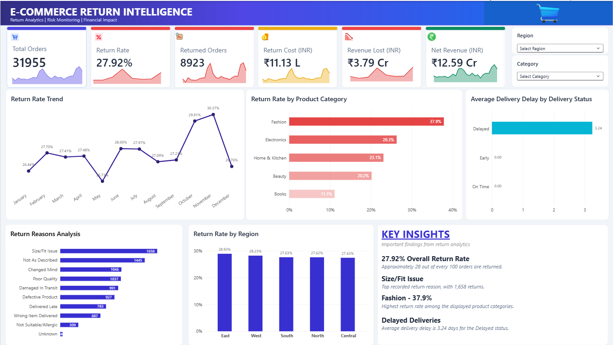
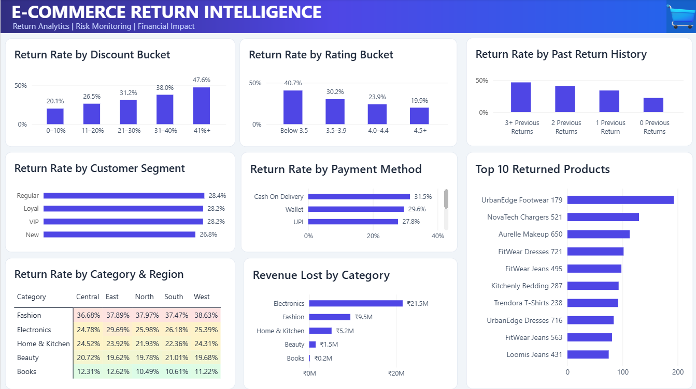

# E-Commerce Return Intelligence | Power BI

An end-to-end **business intelligence and analytics project** that explores a key e-commerce business problem:

> **Why are customers returning products, which categories and products contribute to return-related losses, and what actions could help reduce those losses?**

Built using **Microsoft Power BI, Power Query, and DAX**, this project analyzes a multi-table synthetic e-commerce dataset covering orders, customers, products, deliveries, and returns.

> **Data note:** This project uses synthetic data for educational and portfolio purposes. The observations describe patterns in this dataset and do not represent the performance of a real company. The project currently uses business intelligence and descriptive analytics.

---

## 📊 Dashboard Preview

### Page 1 — Executive Overview



The executive overview summarizes return performance, financial impact, return reasons, product categories, regional patterns, and delivery delays.

### Page 2 — Detailed Return Analysis



The detailed analysis explores return patterns across discounts, product ratings, customer return history, payment methods, customer segments, categories, regions, and individual products.

---

## 🎯 Business Problem

Product returns can affect e-commerce profitability through refunds, reverse-logistics expenses, restocking costs, and inventory challenges.

This dashboard brings key metrics together to help answer:

- How many orders are associated with return requests?
- Which product categories have the highest return rates?
- What are the most frequently recorded return reasons?
- How do discounts and product ratings relate to return rates?
- How do return patterns differ by customer history, payment method, and region?
- How much revenue and return-related cost is associated with returns?

---

## 🎯 Project Objectives

1. Measure overall return performance using KPIs.
2. Analyze return rates across product categories and regions.
3. Identify frequently recorded return reasons.
4. Explore relationships between return rates, discount levels, and product ratings.
5. Compare return patterns across customer segments and previous return history.
6. Analyze refund amounts and return-related costs.
7. Present the findings through an interactive Power BI dashboard.

---

## 🗂️ Dataset Overview

The project uses five related tables.

| Table | Rows | Purpose |
|---|---:|---|
| Customers | 5,200 | Customer details, segments, regions, and return history |
| Products | 520 | Product categories, subcategories, brands, ratings, and costs |
| Orders | 31,955 | Order details, quantities, prices, discounts, and payment methods |
| Deliveries | 31,955 | Delivery status, expected dates, actual dates, and delays |
| Returns | 8,923 | Return requests, statuses, reasons, refunds, and return-related costs |

**Data period:** January 2023 – December 2024

The dataset contains related customer, product, order, delivery, and return information, enabling analysis across multiple business dimensions.

*The row counts above reflect the current project version. They should be updated if the underlying dataset changes.*

---

## 🧹 Data Preparation and Transformation

Power Query was used to prepare the data for reporting.

The data preparation workflow included:

- Handling missing values and data-quality issues.
- Reviewing duplicate records and identifier consistency.
- Standardizing relevant text fields.
- Preparing product rating and cost fields for analysis.
- Creating appropriate relationships between tables.
- Building calculated columns and measures required by dashboard visuals.

The goal was to produce a consistent analytical model for return-performance and financial-impact reporting.

---

## 🏗️ Data Model

The project uses five tables connected through customer, product, and order identifiers.

### Relationships

- `Customers[Customer_ID]` → `Orders[Customer_ID]`
- `Products[Product_ID]` → `Orders[Product_ID]`
- `Orders[Order_ID]` ↔ `Deliveries[Order_ID]`
- `Orders[Order_ID]` ↔ `Returns[Order_ID]`

Orders acts as the central table for sales and order-level analysis, while the related tables provide customer, product, delivery, and return attributes.

---

## 📐 Key DAX Measures

The following examples represent the core calculations used in the project. Verify the column names and formulas against the current `.pbix` file before publishing.

### 1. Total Orders

```dax
Total Orders =
DISTINCTCOUNT(Orders[Order_ID])
```

### 2. Total Returns

```dax
Total Returns =
DISTINCTCOUNT(Returns[Order_ID])
```

### 3. Return Rate

```dax
Return Rate =
DIVIDE(
    [Total Returns],
    [Total Orders],
    0
)
```

Format this measure as a percentage.

### 4. Total Sales

```dax
Total Sales =
SUMX(
    Orders,
    Orders[Unit_Price] *
    Orders[Quantity] *
    (1 - Orders[Discount] / 100)
)
```

This calculation assumes that `Discount` is stored as a percentage between 0 and 100.

### 5. Total Refund Amount

```dax
Total Refund Amount =
SUM(Returns[Refund_Amount])
```

### 6. Return Cost

```dax
Return Cost =
SUM(Returns[Return_Cost]) +
SUM(Returns[Restocking_Cost])
```

### 7. Net Revenue

```dax
Net Revenue =
[Total Sales] -
[Total Refund Amount] -
[Return Cost]
```

*Financial metric definitions depend on the project's data and business assumptions. These calculations should be validated before using them for actual business decisions.*

---

## 📈 Key Performance Indicators

The dashboard highlights the following metrics from the current dataset.

| KPI | Observed Value |
|---|---:|
| Total Orders | 31,955 |
| Total Returns | 8,923 |
| Return Rate | 27.92% |
| Return Cost | Approximately ₹11.13 lakh |
| Revenue Lost / Refund Amount | Approximately ₹3.79 crore |
| Net Revenue | Approximately ₹12.59 crore |
| Average Order Value | Approximately ₹5.16K |
| Total Customers | 5,200 |
| Total Products | 520 |

**Return definition:** The current Total Returns measure counts distinct orders in the Returns table. It includes orders with return requests in different statuses, including rejected and pending requests.

The overall return rate is calculated as:

**Return Rate = Total Returns ÷ Total Orders**

These are project-specific metrics calculated from synthetic data.

---

## 🔍 Dashboard Pages

### Page 1 — Executive Overview

The first page provides a high-level summary of e-commerce return performance.

**Key components:**

- KPI cards for total orders, return rate, returned orders, return cost, revenue lost, and net revenue.
- Return rate trend visualization.
- Return rate by product category.
- Average delivery delay by delivery status.
- Return reasons analysis.
- Return rate by region.
- Region and category slicers.
- Key insights panel.

**Purpose:** Help users understand overall return performance and identify categories, reasons, and regions that deserve further investigation.

### Page 2 — Detailed Analysis

The second page focuses on more detailed return patterns.

**Key components:**

- Return rate by discount bucket.
- Return rate by product rating bucket.
- Return rate by previous return history.
- Return rate by customer segment.
- Return rate by payment method.
- Top 10 returned products.
- Return rate by category and region.
- Refund amount by product category.

**Purpose:** Explore how return rates and financial impact vary across different business dimensions.

---

## 💡 Key Insights

The following observations are based on the current synthetic dataset.

| # | Finding | Business Interpretation |
|---|---|---|
| 1 | Overall return rate is 27.92%. | Approximately 28 out of every 100 orders are associated with a return request under the project's definition. |
| 2 | Fashion has the highest observed category return rate at approximately 37.9%. | Fashion returns warrant further investigation, particularly around size and fit. |
| 3 | Size/Fit Issue is the most frequently recorded return reason, with 1,658 returns. | Better size guides and fit information could be investigated as potential improvements. |
| 4 | Return rates increase across the displayed discount buckets, from approximately 20.1% for 0–10% discounts to 47.6% for 41%+ discounts. | Deep-discount orders may warrant further analysis to understand return patterns. |
| 5 | The displayed rating buckets show approximately 40.7% return rate below a 3.5 rating, compared with approximately 19.9% for the 4.5+ bucket. | Lower-rated products may deserve additional quality and product-description reviews. |
| 6 | Cash on Delivery has an observed return rate of approximately 31.5%. | Payment-method differences could be investigated alongside delivery and customer behavior. |
| 7 | Return rates across customer segments are relatively close, ranging from approximately 26.8% to 28.4%. | Customer segment alone may not explain much of the observed variation. |
| 8 | Electronics has the largest observed refund amount, approximately ₹2.15 crore. | Higher-value products can create a large financial impact even when their return rate is lower than Fashion's. |

**Important:** These observations describe associations in synthetic data. They do not establish that discounts, ratings, or payment methods cause returns. The figures should be rechecked if the dataset or measures change.

---

## 💼 Business Recommendations

| Observation | Potential Action | Intended Benefit |
|---|---|---|
| Fashion has a high return rate. | Improve size charts, fit descriptions, and product imagery. | Help customers make more informed purchase decisions. |
| Size/fit issues are the most frequent return reason. | Review sizing guidance and collect structured fit feedback. | Investigate opportunities to reduce avoidable returns. |
| Electronics has the largest refund amount. | Review product quality checks, packaging, and product descriptions. | Investigate ways to reduce high-value refund exposure. |
| Return rates vary across discount buckets. | Monitor return rates alongside discount campaigns and product margins. | Evaluate whether promotions remain financially effective after returns. |
| Lower-rated products have a higher displayed return rate. | Review customer feedback and investigate recurring product issues. | Identify potential quality or expectation gaps. |
| Cash on Delivery has a higher observed return rate. | Investigate COD return patterns by category, region, and delivery status. | Identify where additional operational analysis may be useful. |

These are proposed actions for further investigation, not guaranteed outcomes.

---

## 🛠️ Tools and Technologies

- **Microsoft Power BI Desktop** — Interactive dashboard development.
- **Power Query** — Data cleaning and transformation.
- **DAX** — Measures and calculated columns.
- **Data Modeling** — Relationships across multiple tables.
- **Data Visualization** — KPI cards, charts, slicers, and heatmaps.

---

## 📁 Repository Structure

```text
E-Commerce-Return-Intelligence/
│
├── README.md
│
├── Dashboard/
│   └── E-Commerce-Return-Intelligence.pbix
│
└── Screenshots/
    ├── page1-overview.png
    └── page2-detailed-analysis.png
```

The repository contains the Power BI project file and dashboard screenshots. Additional notebooks, raw datasets, SQL analysis, and documentation can be added as those project components become available.

---

## 🚀 How to Run the Project

1. Open the repository on GitHub.
2. Navigate to the `Dashboard` folder.
3. Download `E-Commerce-Return-Intelligence.pbix`.
4. Open the file using Microsoft Power BI Desktop.
5. Explore both dashboard pages.
6. Use the slicers and visual interactions to investigate return patterns.

If the report depends on external data-source paths, those paths may need to be updated before refreshing the data.

---

## 🚧 Project Status

- [x] Multi-table data model.
- [x] Data cleaning and transformation in Power Query.
- [x] DAX measures for return and financial KPIs.
- [x] Executive Overview dashboard.
- [x] Detailed Return Analysis dashboard.
- [x] Category, region, discount, rating, and customer-history analysis.
- [x] Dashboard screenshots and GitHub documentation.
---

## 🔮 Future Improvements

Potential enhancements include:

1. **SQL Validation:** Recalculate key KPIs in SQL and compare them with Power BI measures.
2. **Return Risk Score:** Develop a transparent, rule-based score to flag orders that may warrant review.
3. **What-If Analysis:** Estimate how different hypothetical return-rate reductions could affect financial metrics.
4. **Advanced Interactions:** Add drill-through pages, report tooltips, and navigation improvements.
5. **Machine Learning:** If appropriate data and evaluation methods are available, explore a classification model for return-risk prediction.

Any future risk score or machine-learning model would require separate validation and should not be described as implemented until completed.

---

## 👨‍💻 Author

**Manan Gangrade**

Data Analytics | Business Intelligence | Power BI

This project demonstrates practical work in data preparation, data modeling, DAX calculations, interactive visualization, and business-focused analytics.

---

⭐ If you find this project useful, feel free to explore the dashboard and its analytical approach.
